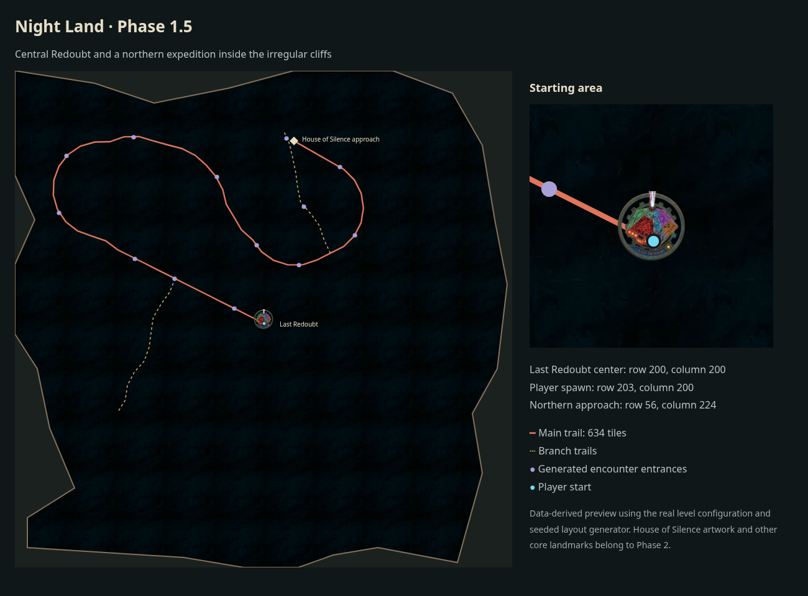

# Phase 1.5: Central Redoubt and a boundary-aware expedition

## Scope and result

The Last Redoubt moves from the southern edge to the center of Level 1. Its 16×16 footprint starts at row 192, column 192, placing its center at row 200, column 200 on the unchanged 400×400 grid. The player starts at row 203, column 200, near the entrance within the building's footprint. The first trail marker remains four to six tiles beyond the building's edge.

The expedition now runs from that spawn to a fixed northern approach at row 56, column 224. This is the future House of Silence location; placing its artwork and the five Watchers remains Phase 2. The main trail targets 600 tiles, approximately half the former full-board winding journey. Its final length is bounded between 600 and 690 tiles, allowing up to 15% for the final turn toward the destination.

The preview uses the actual level configuration, Redoubt artwork, and seeded layout generator. It is a data-derived overview, rather than an in-game screenshot. The seed is 7; other expeditions vary their winding trail, branches, and encounter positions while keeping the same start and destination.

## Authored placement

`config/worldLayout.ts` holds the Redoubt, spawn, destination, and route-length anchors. `config/levels.ts` uses them directly. The three starter items move into the central starting area: the potion at (203, 195), sword at (188, 200), and collectible rock at (198, 210), expressed as (row, column). The level's reach-position objective points to the northern approach.

Fresh game state now takes its spawn and grid dimensions from the selected level. It no longer substitutes the player template's old southern position or Level 1's global grid dimensions when constructing another level. The player template also uses the central spawn as its default.

The river, pools, totem, and existing South-East Watcher retain their authored positions. Named terrain regions and additional landmarks are separate phases. The rough cliff silhouette remains unchanged.

## Trail and encounter clearance

- Trail geometry uses the same cliff walkability mask as player movement. Segment checks include diagonal corner crossings, not just endpoints.
- The northern destination must clear its complete 8×8 approach footprint and authored obstacles. An occupied destination produces a validation error rather than relocating the landmark to a random corner.
- Encounter entrances, generated items, and footstep art must fit completely inside walkable land. Fractional art footprints check every covered cell.
- The starting building exception still lets the trail leave the Redoubt. Once outside, it cannot cut back through authored obstacles.
- Lateral turning margins scale to the shorter journey; the existing bounded turns and branch-length limits remain.
- Encounter entrances and generated items cannot cover the first visible trail marker. This matters on the shorter route because the early note encounter is much closer to the Redoubt.
- Rejected route or placement seeds are retried together, with a bounded 12-attempt layout budget. Permanent configuration errors fail immediately.
- The former obstacle-exempt straight-line fallback is removed. Exhausted generation returns a validation failure instead of creating an invalid route or silently discarding branches.

This phase updates expedition geometry and placement. It does not introduce named terrain collision regions or redesign monster movement.

## Existing saves

The gameboard manifest version advances from 2 to 3, invalidating old expedition snapshots through the existing save identity check. Old saves are preserved, but cannot restore the previous southern layout. Loading an incompatible current save or waypoint shows a message asking the player to begin a new expedition. No save is automatically deleted by this check.

To see the moved Redoubt, choose **Begin an Expedition**. Continuing an older expedition cannot apply the new geography.

## Validation

Completed checks: `pnpm check` passed (80 suites, 633 tests); formatting, ESLint, and TypeScript passed. `pnpm exec expo export --platform web` also succeeded. Existing lint warnings remain non-blocking.

Coverage includes:

- the real fresh-game Redoubt footprint, central spawn, and fixed northern destination;
- per-level grid dimensions and spawn selection;
- 50 deterministic layout seeds, plus repeated random layouts;
- full trunk and branch segments, encounter footprints, and generated marker/item clearance;
- the first marker's four-to-six-tile clearance from the relocated Redoubt;
- blocked destinations and a wall separating the spawn from the destination;
- rejection of old saves and restoration of compatible new saves;
- a visible incompatible-save message without loading the old state.

Run `pnpm check` for repository-wide formatting, ESLint, TypeScript, and the full Jest suite. A production web export provides an additional bundling check.
