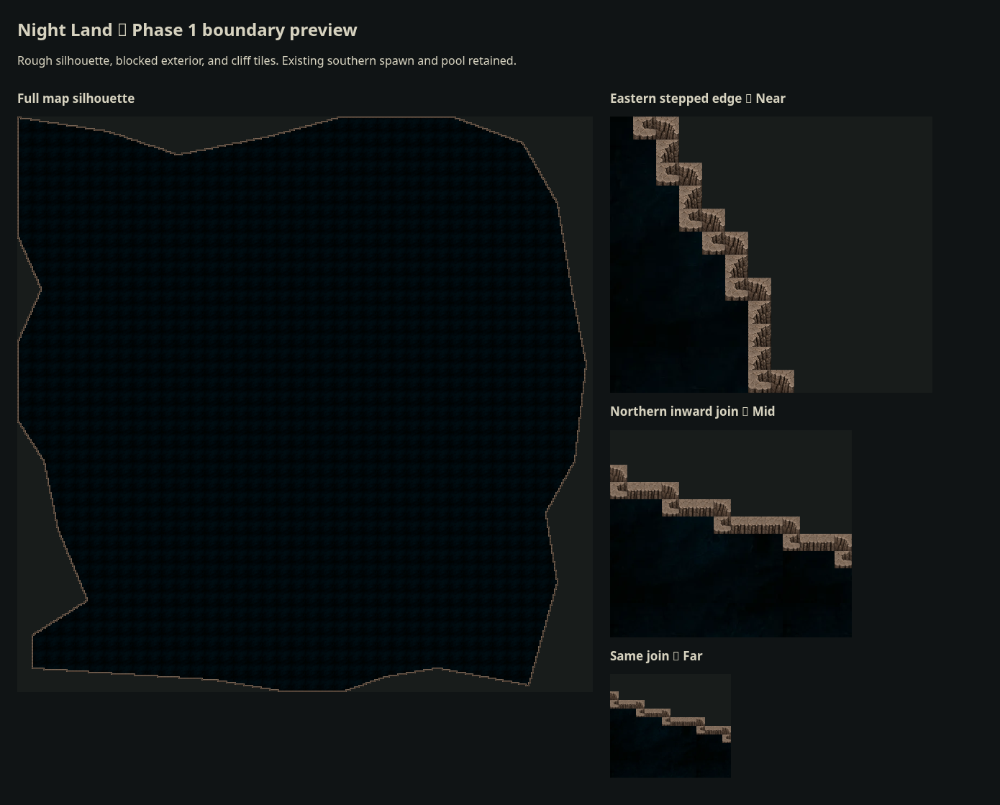

# Phase 1: Rough cliff boundary

**Status:** Implemented rough border and player collision; Phase 1.5 pathing is deferred.

## Result

Level 1 now has an irregular, tile-stepped cliff boundary based on the [supplied map](assets/night-land-map-reference.png). Its rectangular 400×400 coordinate grid remains in place. The cliff rim and exterior cells are blocked for player movement, and the renderer uses the same mask as collision.

The southern tip remains wide enough for the current player spawn. A southwest bay preserves access to the existing healing pool. These are intentional temporary adaptations: closer alignment with the reference can follow relocation of the Redoubt in Phase 1.5.

The preview is a standalone browser rendering of the actual boundary mask and sprite-selection functions against the game's background texture. It shows the silhouette and representative tile scales; it is not a screenshot of a running native game. The [initial preview](assets/phase-1-border-preview-initial.png) is retained for comparison.

## Implementation

| File, relative to `Nightland/nightlandapp` | Responsibility                                                                                       |
| ------------------------------------------ | ---------------------------------------------------------------------------------------------------- |
| `config/mapBoundary.ts`                    | Authored normalized outline; row increases south, column increases east.                             |
| `modules/mapBoundary.ts`                   | Cached land/walkable masks, footprint checks, movement segment checks, directional sprite selection. |
| `components/GameBoard.tsx`                 | Viewport-limited cliff and exterior rendering from the shared mask.                                  |
| `modules/movement.ts`                      | Normal and held movement stop at the new boundary.                                                   |
| `state/slices/movementSlice.ts`            | Guards direct movement actions as well as directional actions.                                       |
| `state/slices/jauntSlice.ts`               | Rejects boundary crossings before spending charges or producing teleport effects.                    |
| `app/game/index.tsx`                       | Shows blocked Jaunt feedback before issuing charge-depletion messages.                               |
| `modules/__tests__/mapBoundary.test.ts`    | Connectivity, authored access, wall coverage, movement, Jaunt, and other-level regression checks.    |

The player currently occupies one tile. Footprint validation also supports wider/taller footprints. Multi-cell movements use a supercover traversal: diagonal crossings check both adjacent cells, preventing corner cutting. Cliff art stays within blocked cells. Other levels retain rectangular borders.

## Artwork

Generated with the built-in imagegen tool. Existing cliff assets remain available.

- Initial atlas: `nightlandapp/assets/images/backgrounds/ui_screens/cliff-wall-atlas.png`.
- Active atlas: `nightlandapp/assets/images/backgrounds/ui_screens/cliff-wall-atlas-v2.png`.
- Layout: four columns, two rows; directional straights above, convex/concave joins below.
- The first atlas left holes in some joins. The second fills each blocked tile with opaque stone so neighboring wall cells meet continuously. Directional texture and repeated-cell seams remain rough rather than final art.

### Final image prompt

> Edit this game cliff atlas for reliable tile connections. Keep EXACTLY the 4-column 2-row uniform square tile grid and same detailed brown gray craggy stone style. Critical correction: every one of the 8 equal square slots must be COMPLETELY filled with opaque rock texture from edge to edge. No transparent areas, black backgrounds, hooks, detached sections, isolated arches, gutters, margins or text. The atlas must be a continuous full rectangular image of rocky cliff tiles. Top row four solid full-square cliff tiles: north facing, east facing, south facing, west facing respectively; perspective rock ridge and cliff face with world lighting consistently upper left, each fully filling its square tile. Bottom row four solid full-square corner rock tiles with ridges turning: northwest convex, northeast convex, northwest concave, northeast concave respectively. Keep all transitions at the middle of tile edges and all edge textures rock so adjacent cells ALWAYS touch visually. There must be no holes in the rock anywhere, even inside corner tiles. These are blocked wall cells so whole cells should read as solid stone. No scenery, no labels. Maintain original texture but make every square an opaque complete solid tile.

## Validation

- Full Jest suite: **79 suites, 627 tests passed** after the boundary and reducer changes.
- TypeScript check passed.
- Changed-file ESLint check passed with no errors; existing warnings elsewhere in the game components remain.
- Formatting and whitespace checks passed.
- New tests verify that the complete walkable mask is connected; current spawn, items, and healing-pool footprint are inside it; every cliff cell has a sprite; and all four straight directions are represented.
- New tests exercise repeated movement into an irregular edge, direct-action bypass attempts, Jaunt rejection without charge loss, multi-cell crossings of the northern indentation, footprint limits, and retention of Level 2's rectangular ring.
- The final Jaunt tap feedback adjustment was checked separately with TypeScript, lint, and targeted movement/Jaunt regression tests.

Native-device interaction and final cliff lighting/seam polish still need visual review in the game.

## Phase 1.5 dependencies

The Redoubt, player spawn, trail generator, encounter placement, and monster movement algorithms have not been relocated or redesigned in this phase.

The existing trail generator assumes rectangular bounds and chooses endpoints on row zero, starting its search at the old corners. It does not yet consume this new boundary mask. Consequently, existing or newly generated trail segments and encounters can conflict with the new cliffs. This phase establishes player blocking; it does **not** certify complete expedition traversal on the old generated layout.

Phase 1.5 must integrate the boundary into route and encounter clearance, relocate the Redoubt and spawn, and choose a reachable northern destination. It should validate complete segments and encounter footprints, rather than only waypoint anchors. Decide how existing saves whose player or encounters lie outside the new land are migrated or restarted; loading an old exterior position is not repaired in Phase 1. Monster boundary/pathing integration remains a separate follow-up requirement.

The supplied reference image is saved for later player help. No help-map interface has been added.
